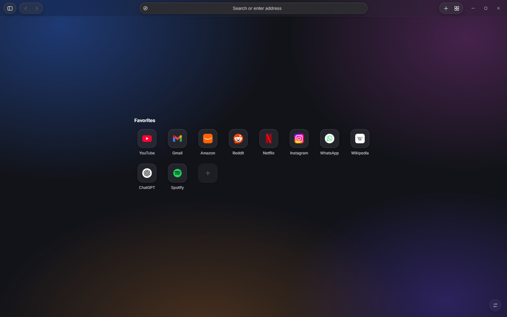
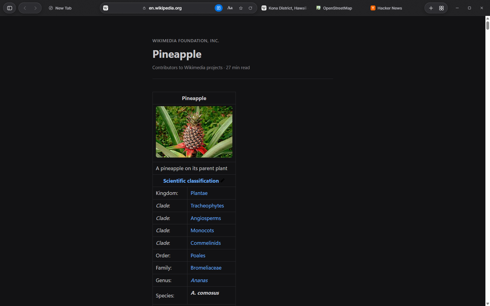
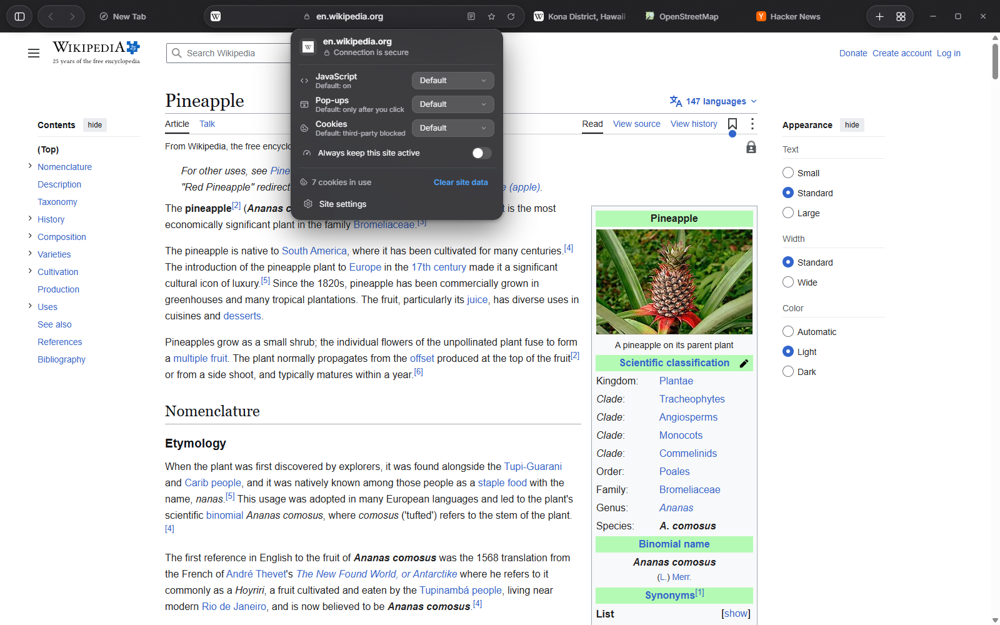
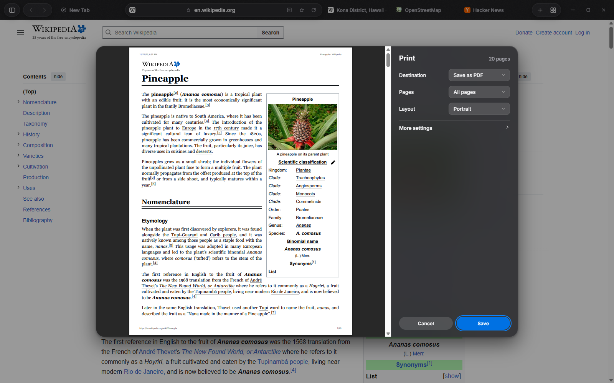
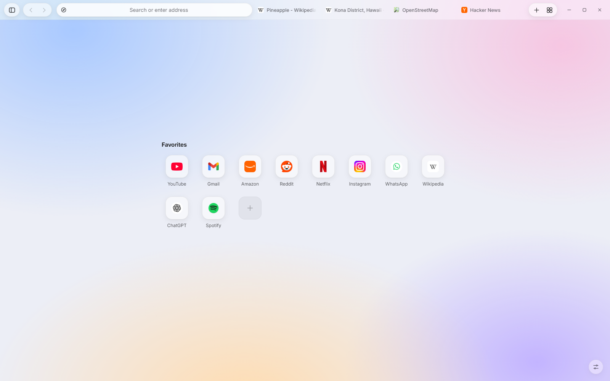

  

<h1 align="center">Kona</h1>

<b>smart design, high performance</b>

  A light, beautiful browser for Windows, with the calm of a well-designed interface 
  and the speed and compatibility of Chromium underneath.

  
  
  
  

  <a href="https://github.com/ruben-acevedo/kona/releases/latest"><b>Download Kona for Windows</b></a>

 

  

## What it is

Kona is a browser for people who like things done well. Tabs and the address share a single compact bar, panels glide in without hurry, and the new tab is a nice place to land. Underneath, it runs the same engine as Google Chrome: sites work the way you expect, Google sign-in works, and extensions come from the Chrome Web Store.

The name comes from the Kona pineapple, a sweet variety grown on the Kona coast of Hawaii.

## Features

### Design
- **One bar** of frosted glass for tabs and the address.
- **A new tab worth landing on:** backgrounds to choose from (Aurora, solid colors or your own photo), favorites with real site icons, and sections you can turn on and off.
- **Light, dark or system theme.**
- **Tab overview:** every tab as a live thumbnail, and you can drive it from the keyboard.
- **Reader:** a clean, Safari-style version of any article, with 8 fonts, 4 backgrounds, text size and *Listen to Page*.
- **Print preview:** the whole sheet on the left and every option on the right.
- **Illustrated profile avatars** in the style of the pineapple logo.
- **Subtle interface sounds**, for mouse and keyboard alike, which you can turn off.

### Intelligence
- **An address bar that thinks ahead:** inline autocomplete for sites you visit, suggestions from your search engine, history and favorites, *Switch to tab*, and site search shortcuts (type `yt`, press <kbd>Tab</kbd>, search YouTube).
- **Passwords built in:** saved and filled in automatically, encrypted by Windows, protected by **Windows Hello**, with a strong password generator. You can import them from Chrome.
- **Addresses and cards** filled in for you on checkout forms.
- **Memory Saver:** tabs you haven't used in a while go to sleep and wake up instantly when you click them. It never touches the tab that's playing music, sharing your screen or holding a half-filled form.
- **Remembers what you prefer:** zoom per site, and JavaScript, pop-ups and cookies per site from the lock icon.
- **Crash recovery:** if something goes wrong, every window comes back with its tabs.
- **Sensible pop-ups:** real pop-ups (sign-in windows, call controls) open as windows; ad pop-ups are blocked.

### Everything you expect from a browser
- **Multiple windows:** drag a tab out to make a new window, or into another one.
- **Pinned tabs, tab groups** and favorites with folders.
- **Sidebar** with tabs, groups, favorites, reading list, downloads and history.
- **Netflix, Spotify, Prime Video and Disney+**, with protected video (Widevine).
- **Extensions** from the Chrome Web Store, with toolbar buttons and popups (ad blockers, password managers…).
- **Install sites as apps:** they get their own window, Start menu icon and taskbar icon.
- **Screen sharing** for Meet, Teams, Zoom and Discord.
- **Media controls** for whatever is playing in any tab, plus your keyboard's media keys.
- PDFs right in the tab, find in page, full screen and per-tab mute.
- Import favorites, history and extensions from **Chrome, Edge and Brave**.
- **Profiles** that are truly separate (each with its own sign-ins, extensions, history and settings), and private browsing that deletes everything when you leave.
- **English, Portuguese and Spanish**, and fully usable from the keyboard and with a screen reader.

### Performance and security
- **Chromium underneath:** sites, Google sign-in and web apps behave exactly as in Chrome, in Chromium's sandbox.
- **Light on memory:** sleeping tabs give their memory back, and when you open Kona only recent tabs load right away.
- **Scam and malware protection:** dangerous sites are stopped before they open. Kona checks against open lists of about 500,000 sites, right on your computer, so your browsing never leaves it. You can add your own Google Safe Browsing key.
- **Dangerous download warnings** for files that can run programs, and every download is scanned by Windows' antivirus.
- **HTTPS first**, secure encrypted DNS, and third-party cookies blocked by default.
- **Global Privacy Control** and WebRTC that doesn't expose your local network.
- **Always up to date:** new versions download in the background and install when you close Kona.

<table>
  <tr>
    <td width="50%"></td>
    <td width="50%"></td>
  </tr>
  <tr>
    <td align="center">Tab overview (Alt+V)</td>
    <td align="center">Sidebar (Alt+Z)</td>
  </tr>
  <tr>
    <td width="50%"></td>
    <td width="50%"></td>
  </tr>
  <tr>
    <td align="center">Reader (Ctrl+Shift+R)</td>
    <td align="center">Site settings, from the lock icon</td>
  </tr>
  <tr>
    <td width="50%"></td>
    <td width="50%"></td>
  </tr>
  <tr>
    <td align="center">Print preview (Ctrl+P)</td>
    <td align="center">Light theme</td>
  </tr>
</table>

## Install

1. Download **Kona-Setup** from the [latest release](https://github.com/ruben-acevedo/kona/releases/latest).
2. Open it, check the install location (by default `C:\Program Files\Kona`) and click **Install**. Windows asks for administrator permission. Installing takes a few seconds, and Kona opens when it's done.

Kona shows up in the Start menu and on the desktop, and you can make it your default browser. Updates arrive on their own. On first launch, Kona offers to bring your favorites, history and extensions from another browser.

> **If Windows shows "Windows protected your PC":** click **More info**, then **Run anyway**. The warning appears because the installer isn’t digitally signed yet. It doesn’t mean anything is wrong with the file.

**Requirements:** Windows 10 or 11, 64-bit.

**Uninstall:** Settings → Apps → Installed apps → Kona → Uninstall. You choose whether to also delete your data (favorites, history, profiles, passwords and sign-ins).

## Shortcuts

| Shortcut | What it does |
| --- | --- |
| <kbd>Ctrl</kbd>+<kbd>T</kbd> | New tab |
| <kbd>Ctrl</kbd>+<kbd>N</kbd> | New window |
| <kbd>Ctrl</kbd>+<kbd>W</kbd> | Close tab |
| <kbd>Ctrl</kbd>+<kbd>Shift</kbd>+<kbd>T</kbd> | Reopen closed tab |
| <kbd>Ctrl</kbd>+<kbd>Tab</kbd> | Next tab |
| <kbd>Ctrl</kbd>+<kbd>1</kbd>…<kbd>8</kbd> / <kbd>Ctrl</kbd>+<kbd>9</kbd> | Go to tab 1–8 / last tab |
| <kbd>Ctrl</kbd>+<kbd>PgUp</kbd> / <kbd>PgDn</kbd> | Previous / next tab |
| <kbd>Ctrl</kbd>+<kbd>Shift</kbd>+<kbd>PgUp</kbd> / <kbd>PgDn</kbd> | Move tab left / right |
| <kbd>Ctrl</kbd>+<kbd>L</kbd> | Go to the address bar |
| <kbd>Alt</kbd>+<kbd>V</kbd> | Tab overview (arrows to choose, Enter to open) |
| <kbd>Alt</kbd>+<kbd>Z</kbd> | Sidebar (arrows to move, Enter to open) |
| <kbd>Ctrl</kbd>+<kbd>D</kbd> | Add the page to Favorites |
| <kbd>Ctrl</kbd>+<kbd>Shift</kbd>+<kbd>D</kbd> | Save to Reading List |
| <kbd>Ctrl</kbd>+<kbd>H</kbd> | History |
| <kbd>Ctrl</kbd>+<kbd>J</kbd> | Downloads |
| <kbd>Ctrl</kbd>+<kbd>F</kbd> | Find in page |
| <kbd>Ctrl</kbd>+<kbd>Shift</kbd>+<kbd>R</kbd> | Reader |
| <kbd>Ctrl</kbd>+<kbd>P</kbd> | Print |
| <kbd>F11</kbd> | Full screen |
| <kbd>Ctrl</kbd>+<kbd>+</kbd> / <kbd>Ctrl</kbd>+<kbd>-</kbd> / <kbd>Ctrl</kbd>+<kbd>0</kbd> | Zoom in, out, reset (remembered per site) |
| <kbd>Alt</kbd>+<kbd>←</kbd> / <kbd>Alt</kbd>+<kbd>→</kbd> | Back / Forward |
| <kbd>Ctrl</kbd>+<kbd>Shift</kbd>+<kbd>N</kbd> | Private browsing |
| <kbd>Ctrl</kbd>+<kbd>,</kbd> | Settings |

## Your data

Everything Kona stores (favorites, history, profiles, passwords, addresses, cards, settings and sign-ins) stays on your computer. Passwords and cards are encrypted by Windows. Kona has no account, sends no statistics and collects nothing about you.

Besides the sites you open, Kona only connects to:
- your chosen search engine, for search suggestions;
- the sites in your favorites, to show their icons;
- Quad9’s secure DNS, which you can turn off in Settings;
- the public scam and malware lists, downloaded every few hours (the sites you visit are checked on your computer and never sent);
- Google, once, to download the Widevine component that plays protected video;
- the Chrome Web Store, when you install extensions;
- GitHub, to check for updates.

Found a bug? **Settings → About Kona → Report a problem** opens a GitHub issue with your Kona and Windows versions already filled in. Nothing is sent until you post it.

## Author and license

Created by **Rubén Acevedo**.

Open source under the [MIT license](LICENSE). Kona is built on [Chromium](https://www.chromium.org) and [Electron](https://www.electronjs.org) ([castLabs' build](https://github.com/castlabs/electron-releases) with Widevine), with Mozilla's [Readability](https://github.com/mozilla/readability) (Apache 2.0) for Reader, each under its own license. The full list is in **Settings → About Kona → Open-source licenses**.
