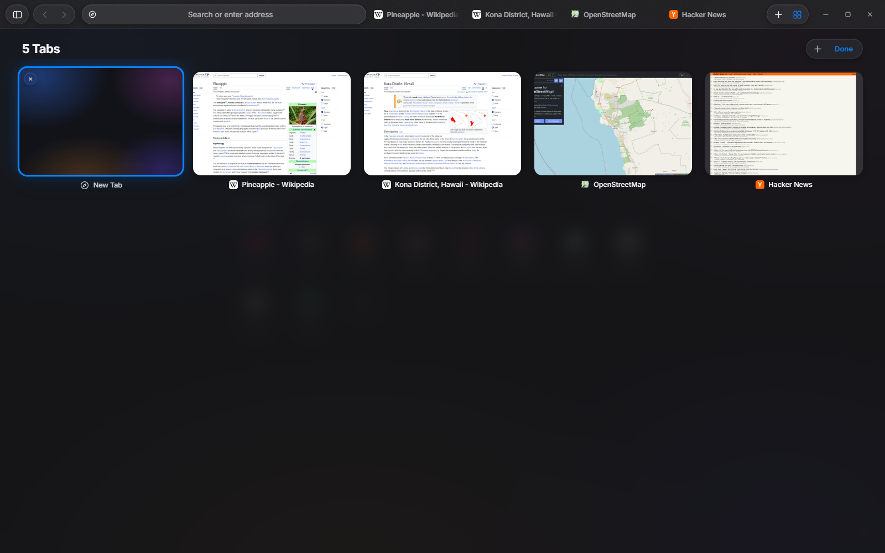
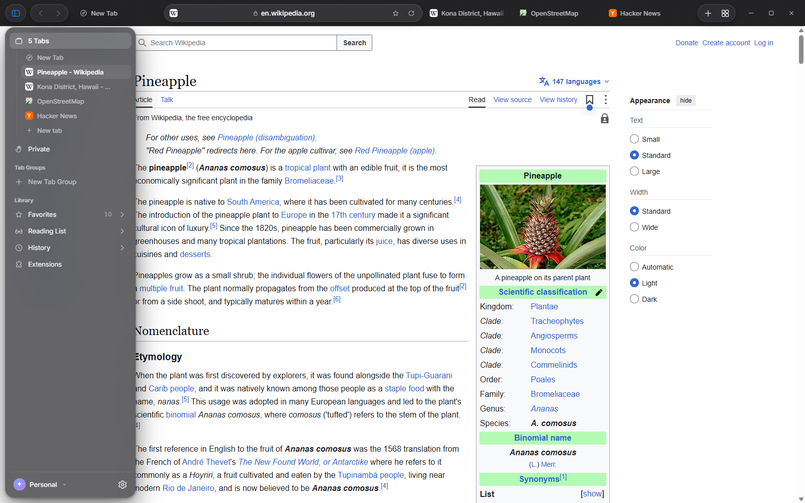

  

<h1 align="center">Kona</h1>

<b>smart design, high performance</b>

  A light, beautiful browser for Windows, with the calm of a well-designed interface 
  and the speed and compatibility of Chromium underneath.

  
  
  

  <a href="https://github.com/ruben-acevedo/kona/releases/latest"><b>Download Kona for Windows</b></a>

 

  

## What it is

Kona is a browser for people who like things done well. Tabs and the address share a single compact bar, panels glide in without hurry, and the new tab is a nice place to land. Underneath, it runs the same engine as Google Chrome: sites work the way you expect, Google sign-in works, and extensions come from the Chrome Web Store.

The name comes from the Kona pineapple, a sweet variety grown on the Kona coast of Hawaii.

## Features

**Design**
- One frosted-glass bar for tabs and the address.
- A new tab with backgrounds to choose from (Aurora, solid colors or your own photo), favorites, and sections you can turn on and off.
- Light, dark or system theme.
- An overview of all your tabs as thumbnails, keyboard friendly too.
- Subtle interface sounds, which you can turn off.

**Browsing**
- An address bar with suggestions from your search engine, your history and recent searches.
- Your choice of search engine: Google, DuckDuckGo, Bing, Ecosia or Brave Search.
- A sidebar with tabs, tab groups, favorites, reading list and history.
- Truly separate profiles, each with its own sign-ins, extensions, history and settings.
- Private browsing that saves nothing and deletes everything when you leave.
- Extensions from the Chrome Web Store, such as ad blockers.

**Privacy and security**
- Third-party cookies blocked by default.
- Always tries HTTPS before HTTP.
- Secure, encrypted DNS that also blocks known scam and malware sites.
- The Global Privacy Control signal, which asks sites not to sell your data.
- Camera, microphone, location and notifications only with your permission, remembered per site.
- WebRTC without exposing your local network addresses.
- Pages isolated in Chromium’s sandbox, and cookies encrypted on disk.

**Always up to date**
- Kona checks for new versions on its own, downloads them in the background and installs them when you close the browser.

<table>
  <tr>
    <td width="50%"></td>
    <td width="50%"></td>
  </tr>
  <tr>
    <td align="center">Tab overview (Alt+V)</td>
    <td align="center">Sidebar (Alt+Z)</td>
  </tr>
</table>

   
  Light theme

## Install

1. Download **Kona-Setup** from the [latest release](https://github.com/ruben-acevedo/kona/releases/latest).
2. Open it, check the install location (by default `C:\Program Files\Kona`) and click **Install**. Windows asks for administrator permission; the installation takes a few seconds and opens Kona at the end.

Kona shows up in the Start menu and on the desktop. Updates arrive on their own.

> **If Windows shows "Windows protected your PC":** click **More info**, then **Run anyway**. The warning appears because the installer isn’t digitally signed yet. It doesn’t mean anything is wrong with the file.

**Requirements:** Windows 10 or 11, 64-bit.

**Uninstall:** Settings → Apps → Installed apps → Kona → Uninstall. You choose whether to also delete your data (favorites, history, profiles and sign-ins).

## Shortcuts

| Shortcut | What it does |
| --- | --- |
| <kbd>Ctrl</kbd>+<kbd>T</kbd> | New tab |
| <kbd>Ctrl</kbd>+<kbd>W</kbd> | Close tab |
| <kbd>Ctrl</kbd>+<kbd>Tab</kbd> | Next tab |
| <kbd>Ctrl</kbd>+<kbd>L</kbd> | Go to the address bar |
| <kbd>Alt</kbd>+<kbd>V</kbd> | Tab overview (arrows to choose, Enter to open) |
| <kbd>Alt</kbd>+<kbd>Z</kbd> | Sidebar |
| <kbd>Ctrl</kbd>+<kbd>D</kbd> | Add the page to Favorites |
| <kbd>Ctrl</kbd>+<kbd>Shift</kbd>+<kbd>D</kbd> | Save to Reading List |
| <kbd>Ctrl</kbd>+<kbd>H</kbd> | History |
| <kbd>Ctrl</kbd>+<kbd>Shift</kbd>+<kbd>N</kbd> | Private browsing |
| <kbd>Ctrl</kbd>+<kbd>,</kbd> | Settings |

## Your data

Everything Kona stores (favorites, history, profiles, settings and sign-ins) stays on your computer. Kona has no account, sends no statistics and collects nothing about you. Besides the sites you open, it only connects to your chosen search engine (for search suggestions), to the sites in your favorites (to show their icons), to Quad9’s secure DNS (can be turned off in Settings), to the Chrome Web Store (when you install extensions) and to GitHub (to check for updates).

## Author and license

Created by **Rubén Acevedo**.

Open source under the [MIT license](LICENSE). Kona uses [Electron](https://www.electronjs.org) and [Chromium](https://www.chromium.org), each under its own license.
