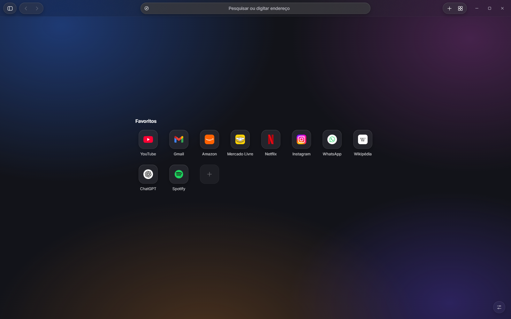
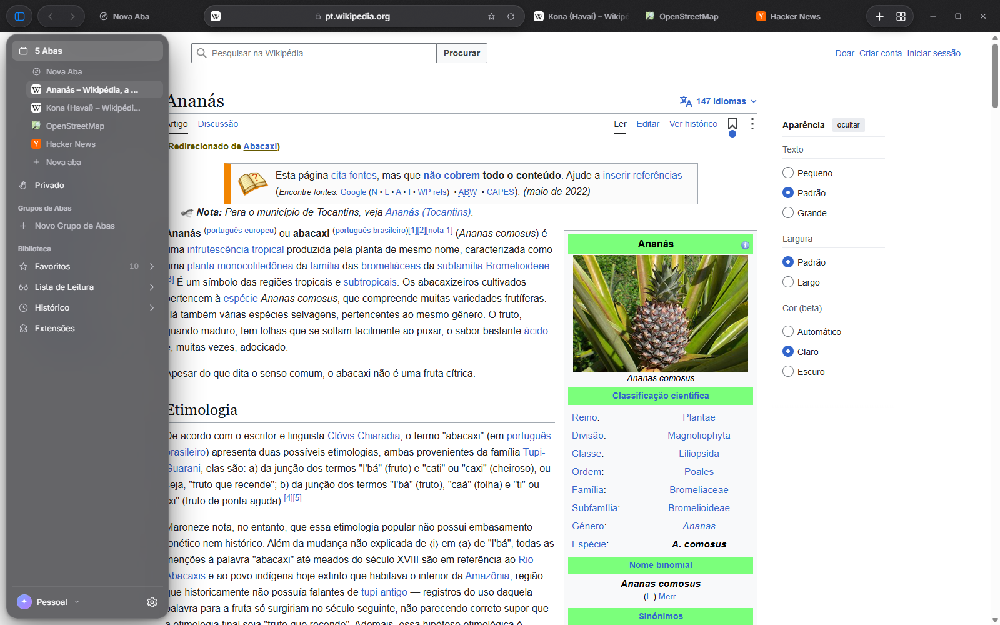

  

<h1 align="center">Kona</h1>

<b>design inteligente, alta performance</b>

  Um navegador leve e bonito para Windows, com a calma de uma interface bem desenhada 
  e a velocidade e a compatibilidade do Chromium por baixo.

  
  
  

  <a href="https://github.com/ruben-acevedo/kona/releases/latest"><b>Baixar o Kona para Windows</b></a>

 

  

## O que é

O Kona é um navegador para quem gosta de coisas bem feitas. Abas e endereço dividem uma única barra compacta, os painéis deslizam sem pressa e a nova aba é um lugar bonito de se abrir. Por baixo, é o mesmo motor do Google Chrome: os sites funcionam como você espera, o login do Google funciona, e as extensões vêm da Chrome Web Store.

O nome vem do abacaxi Kona, uma variedade doce cultivada na costa de Kona, no Havaí.

## Recursos

**Design**
- Barra única com abas e endereço, em vidro fosco.
- Nova aba com fundos para escolher (Aurora, cores sólidas ou uma foto sua), favoritos e seções que você liga e desliga.
- Tema claro, escuro ou o do sistema.
- Visão geral de todas as abas em miniaturas, também pelo teclado.
- Sons discretos ao navegar pela interface, que podem ser desligados.

**Navegação**
- Barra de endereço com sugestões do buscador, do histórico e das buscas recentes.
- Buscador à sua escolha: Google, DuckDuckGo, Bing, Ecosia ou Brave Search.
- Menu lateral com abas, grupos de abas, favoritos, lista de leitura e histórico.
- Perfis separados de verdade, cada um com os próprios logins, extensões, histórico e ajustes.
- Modo privado que não grava nada e apaga tudo ao sair.
- Extensões da Chrome Web Store, como bloqueadores de anúncio.

**Privacidade e segurança**
- Cookies de terceiros bloqueados por padrão.
- Sempre tenta HTTPS antes de HTTP.
- DNS seguro e criptografado, que também bloqueia sites conhecidos de golpes e malware.
- Sinal Global Privacy Control, que pede aos sites para não vender seus dados.
- Câmera, microfone, localização e notificações só com a sua permissão, guardada por site.
- WebRTC sem expor os endereços da sua rede local.
- Páginas isoladas na sandbox do Chromium e cookies criptografados no disco.

**Sempre atualizado**
- O Kona procura versões novas sozinho, baixa em segundo plano e instala quando você fecha o navegador.

<table>
  <tr>
    <td width="50%"></td>
    <td width="50%"></td>
  </tr>
  <tr>
    <td align="center">Visão geral das abas (Alt+V)</td>
    <td align="center">Menu lateral (Alt+Z)</td>
  </tr>
</table>

   
  Tema claro

## Instalar

1. Baixe o **Kona-Setup** na página da [versão mais recente](https://github.com/ruben-acevedo/kona/releases/latest).
2. Abra o arquivo. A instalação leva poucos segundos, não pede senha de administrador e abre o Kona no final.

O Kona fica no Menu Iniciar e na área de trabalho. As atualizações chegam sozinhas.

> **Se o Windows mostrar "O Windows protegeu o computador":** clique em **Mais informações** e depois em **Executar assim mesmo**. O aviso aparece porque o instalador ainda não tem assinatura digital. Ele não indica nenhum problema com o arquivo.

**Requisitos:** Windows 10 ou 11, 64 bits.

**Desinstalar:** Configurações → Aplicativos → Aplicativos instalados → Kona → Desinstalar. Você escolhe se quer apagar também seus dados (favoritos, histórico, perfis e logins).

## Atalhos

| Atalho | O que faz |
| --- | --- |
| <kbd>Ctrl</kbd>+<kbd>T</kbd> | Nova aba |
| <kbd>Ctrl</kbd>+<kbd>W</kbd> | Fechar aba |
| <kbd>Ctrl</kbd>+<kbd>Tab</kbd> | Próxima aba |
| <kbd>Ctrl</kbd>+<kbd>L</kbd> | Ir para a barra de endereço |
| <kbd>Alt</kbd>+<kbd>V</kbd> | Visão geral das abas (setas para escolher, Enter para abrir) |
| <kbd>Alt</kbd>+<kbd>Z</kbd> | Menu lateral |
| <kbd>Ctrl</kbd>+<kbd>D</kbd> | Favoritar a página |
| <kbd>Ctrl</kbd>+<kbd>Shift</kbd>+<kbd>D</kbd> | Guardar na lista de leitura |
| <kbd>Ctrl</kbd>+<kbd>H</kbd> | Histórico |
| <kbd>Ctrl</kbd>+<kbd>Shift</kbd>+<kbd>N</kbd> | Modo privado |
| <kbd>Ctrl</kbd>+<kbd>,</kbd> | Configurações |

## Seus dados

Tudo o que o Kona guarda (favoritos, histórico, perfis, ajustes e logins) fica só no seu computador. O Kona não tem conta, não envia estatísticas e não coleta nada sobre você. Além dos sites que você abre, ele só se conecta ao buscador escolhido (para as sugestões de busca), aos sites dos seus favoritos (para mostrar os ícones), ao DNS seguro da Quad9 (desligável em Configurações), à Chrome Web Store (quando você instala extensões) e ao GitHub (para buscar atualizações).

## Autoria e licença

Criado por **Rubén Acevedo**.

Código aberto sob a [licença MIT](LICENSE). O Kona usa o [Electron](https://www.electronjs.org) e o [Chromium](https://www.chromium.org), cada um com a própria licença.
